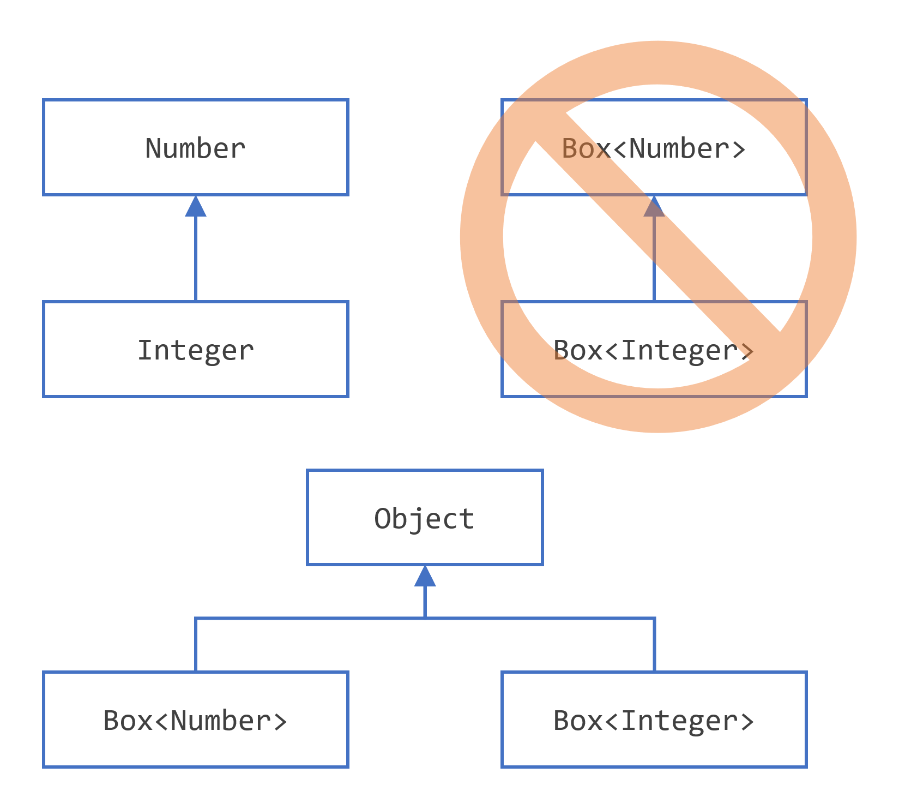
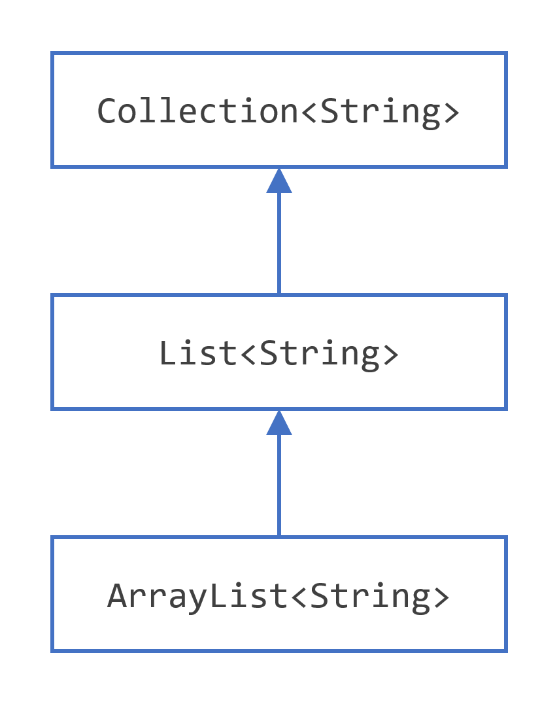

# 泛型（Generics）与 Lambda 表达式

> 来源：Oracle 官方 [Dev.java 教程](https://dev.java/learn/) →《Generics》《Lambda Expressions》
> 忠实翻译，保留全部代码示例与官方配图。

---

## 第一部分：泛型（Generics）

### 一、为什么使用泛型？

**简言之，泛型让类型（类和接口）在定义类、接口和方法时能够成为参数。** 与方法声明中更熟悉的形参（formal parameter）类似，类型参数提供了一种用不同输入复用同一代码的方式。区别在于：形参的输入是**值**，而类型参数的输入是**类型**。

使用泛型的代码相比非泛型代码有很多好处：

1. **编译期更强的类型检查**。Java 编译器会对泛型代码应用强类型检查，如果代码违反类型安全就报错。修复编译期错误比修复运行时错误容易得多——后者往往很难定位。
2. **消除类型转换（casting）**。下面这段不带泛型的代码需要强制转换：

   ```java
   List list = new ArrayList();
   list.add("hello");
   String s = (String) list.get(0);   // 必须强转
   ```

   用泛型重写后，不再需要强转：

   ```java
   List<String> list = new ArrayList<String>();
   list.add("hello");
   String s = list.get(0);   // 编译器已知返回 String，无需强转
   ```

3. **让程序员能实现泛型算法**。借助泛型，程序员可以实现在不同类型集合上工作、可定制、且类型安全、更易读的泛型算法。

### 二、泛型类型（Generic Types）

**泛型类型是参数化于类型之上的泛型类或泛型接口。** 下面的 `Box` 类会被改造来演示这一概念。

一个**简单的 `Box` 类**（非泛型版本）：

```java
public class Box {
    private Object object;

    public void set(Object object) { this.object = object; }
    public Object get() { return object; }
}
```

由于它的方法接收或返回 `Object`，你可以自由传入任何东西，只要不是基本类型。但**无法在编译期验证这个类到底怎么被使用**：一段代码可能往箱子里放一个 `Integer` 然后期望取出 `Integer` 类型对象，而另一段代码可能误传一个 `String`，结果导致运行时 `ClassCastException`。

**泛型版 `Box` 类**——用类型参数 `T` 替代 `Object`：

```java
public class Box<T> {
    private T t;

    public void set(T t) { this.t = t; }
    public T get() { return t; }
}
```

如你所见，所有出现 `Object` 的地方都换成了 `T`。类型参数（type parameter）就是普通的标识符，你完全可以使用更长的名字（如 `Box<Apple>`），但按惯例使用**单个大写字母**（`T` type、`E` element、`K` key、`V` value）。

#### 类型参数命名惯例

| 类型参数 | 含义 |
|---------|------|
| `E` | Element（元素，常用于集合框架） |
| `K` | Key（键，如 Map） |
| `V` | Value（值，如 Map） |
| `N` | Number（数值） |
| `T` | Type（类型） |
| `S`、`U`、`V` 等 | 第 2、3、4 个类型 |

#### 实例化泛型类型

```java
Box<Integer> integerBox = new Box<Integer>();
```

在 Java SE 7 及以后，只要编译器能推断，你可用**类型推断**（diamond 运算符 `<>`）替换构造器的类型实参：

```java
Box<Integer> integerBox = new Box<>();
```

#### 多个类型参数

一个泛型类型可以有**多个类型参数**。例如泛型接口 `Pair<K, V>`：

```java
public interface Pair<K, V> {
    public K getKey();
    public V getValue();
}
```

实现它的 `OrderedPair` 类：

```java
public class OrderedPair<K, V> implements Pair<K, V> {

    private K key;
    private V value;

    public OrderedPair(K key, V value) {
        this.key = key;
        this.value = value;
    }

    public K getKey()   { return key; }
    public V getValue() { return value; }
}
```

实例化 `OrderedPair` 的两种写法：

```java
Pair<String, Integer> p1 = new OrderedPair<String, Integer>("Even", 8);
Pair<String, Integer> p2 = new OrderedPair<>("hello", 8);   // 类型推断
```

#### 参数化类型

你还可以把参数化类型本身作为类型实参（嵌套泛型）。例如 `OrderedPair<String, Box<Integer>>`：

```java
OrderedPair<String, Box<Integer>> p = new OrderedPair<>("primes", new Box<Integer>());
```

#### 原始类型（Raw Types）

**原始类型是不带类型实参的泛型类或接口的名称。** 例如：

```java
Box rawBox = new Box();
```

原始类型出现在从泛型代码迁移到非泛型代码的过渡期（如 JDK 5 之前的旧代码）。但**不建议在新代码中使用原始类型**——它们绕过了泛型的安全性检查。

### 三、泛型方法（Generic Methods）

**泛型方法是引入自己的类型参数的方法**（与泛型类不同，泛型方法引入的类型参数限定在该方法范围内）。其语法：在方法返回类型前，用尖括号包住类型参数列表。

下面是用泛型方法实现的两个版本 `Util` 类，比较两个对象是否相等：

```java
public class Util {
    public static <K, V> boolean compare(Pair<K, V> p1, Pair<K, V> p2) {
        return p1.getKey().equals(p2.getKey()) &&
               p1.getValue().equals(p2.getValue());
    }
}
```

调用方式如下：

```java
Pair<Integer, String> p1 = new OrderedPair<>(1, "apple");
Pair<Integer, String> p2 = new OrderedPair<>(2, "pear");
boolean same = Util.<Integer, String>compare(p1, p2);
```

类型可被推断，所以尖括号里的类型实参可省略：

```java
boolean same = Util.compare(p1, p2);
```

### 四、受限类型参数（Bounded Type Parameters）

有时你会想限制泛型方法/类只接受特定类型范围内的实参。例如，你想计算三个对象的最小值，要求它们相互比较。为此，可以声明一个**受限类型参数**，用 `extends` 限定上界。

```java
public static <T extends Comparable<T>> T maximum(T x, T y, T z) {
    T max = x;
    if (y.compareTo(max) > 0) max = y;
    if (z.compareTo(max) > 0) max = z;
    return max;
}
```

这里的 `<T extends Comparable<T>>` 声明 `T` 必须实现 `Comparable<T>` 接口。调用：

```java
System.out.println(maximum(3, 4, 5));        // 5
System.out.println(maximum("apple", "pear", "banana"));  // pear
```

可以限定**多个边界**，用 `&` 分隔，类边界在前、接口边界在后：

```java
<T extends Number & Comparable<T>>
```

一个类型参数只能有一个类边界、但可以有多个接口边界。

### 五、类型推断（Type Inference）

**类型推断是 Java 编译器自动推断能有效调用方法、让类型实参更容易书写的能力。** 编译器可利用目标类型（target typing）推断泛型调用的类型参数。

diamond 运算符（`<>`）：

```java
List<String> list = new ArrayList<>();   // 编译器推断 String
```

类型推断还用于泛型方法和构造器。Java SE 9 及以后，可在匿名内部类中使用 diamond：

```java
List<String> list = new ArrayList<>() {
    { add("A"); add("B"); }
};
```

### 六、通配符（Wildcards）

**通配符 `?` 表示未知类型。** 它是泛型中强大多变的工具，形式有几种：

#### 上界通配符（Upper Bounded Wildcards）`? extends T`

表示类型是 `T` 或 `T` 的子类。常用于「读」的场景。

```java
public static void process(List<? extends Number> list) {
    for (Number n : list) { System.out.println(n); }
}
```

可以用 `process(listOfIntegers)`、`process(listOfDoubles)` 等，只要是 `Number` 的子类集合。

#### 下界通配符（Lower Bounded Wildcards）`? super T`

表示类型是 `T` 或 `T` 的超类。常用于「写」的场景（如 `Collections.copy`、`addAll`）。

```java
public static void addNumbers(List<? super Integer> list) {
    for (int i = 1; i <= 10; i++) {
        list.add(i);
    }
}
```

#### 无界通配符（Unbounded Wildcards）`?`

表示「任何类型」，常用于：

- 编写只使用 `Object` 提供的方法的方法；或
- 不依赖类型参数的通用方法。

```java
public static void printList(List<?> list) {
    for (Object elem : list) {
        System.out.print(elem + " ");
    }
}
```

#### 通配符与子类型



**关键点**：`List<Integer>` **不是** `List<Number>` 的子类型，尽管 `Integer` 是 `Number` 的子类型。两者毫无关系，编译期都会报错。这正是通配符存在的原因——它让你能表达「某个未知的子类型集合」。



但**数组的协变性**与此不同：`Integer[]` 是 `Number[]` 的子类型。

### 七、类型擦除（Type Erasure）

**类型擦除是 Java 泛型的实现机制：编译器在编译期擦除所有泛型类型信息，把它们转换为原始类型或受限类型。**

擦除的目的：让泛型代码在**不破坏 JDK 5 之前非泛型代码二进制兼容性**的前提下工作。

过程：

1. 用其左边界（第一个 `extends` 的类型）替换泛型类型中的类型参数，若无边界则替换为 `Object`。
2. 插入必要的类型转换以保持类型安全。
3. 生成桥接方法（bridge method）以保持扩展泛型类型的多态性。

例如 `Box<T>` 擦除后变成原始 `Box`：

```java
public class Box {
    private Object t;
    public void set(Object t) { this.t = t; }
    public Object get() { return t; }
}
```

受限类型参数 `<T extends Comparable<T>>` 擦除后 `T` 被替换为 `Comparable`。

**类型擦除的后果**：在运行时你**无法知道**一个 `List` 的具体类型实参——所有 `List` 运行时都是 `List`。因此 `if (list instanceof List<String>)` 是编译错误；`List<String>[]` 数组创建也是编译错误（可以创建 `List<?>[]`）。

### 八、泛型的限制（Restrictions）

以下操作在编译期会报错：

| 限制 | 原因 |
|------|------|
| 不能用基本类型做类型参数（如 `Box<int>`） | 类型参数只能是引用类型，需用 `Box<Integer>` |
| 不能创建类型参数的实例（`new T()`） | 类型擦除后 `T` 是 `Object` 或其他，无构造器保证 |
| 不能声明静态字段为类型参数类型（`static T t`） | 类型参数跨实例共享，但擦除后无法区分 |
| 不能对类型参数用 `instanceof`（`o instanceof T`） | 擦除后无类型信息 |
| 不能创建参数化类型数组（`new List<String>[10]`） | 无法保证数组元素类型安全 |
| 不能 catch 类型参数类型的异常（`catch (T e)`） | 异常类型在运行时未知 |
| 一个类型参数只能一个类边界 | 类只能继承一个类 |

### 九、泛型核心速查

| 概念 | 语法 | 用途 |
|------|------|------|
| 泛型类 | `class Box<T>` | 参数化类 |
| 泛型方法 | `<T> T method(T arg)` | 方法级类型参数 |
| 受限参数 | `<T extends Comparable<T>>` | 限定上界，可调用边界方法 |
| 多边界 | `<T extends A & B>` | 一类别边 + 多接口边 |
| 上界通配 | `? extends Number` | 读集合 |
| 下界通配 | `? super Integer` | 写集合 |
| 无界通配 | `?` | 未知类型，通用方法 |
| 类型擦除 | 编译期擦除 | 向后兼容的底层机制 |
| diamond | `new Box<>()` | 类型推断 |

---

## 第二部分：Lambda 表达式（Lambda Expressions）

### 一、你的第一个 Lambda 表达式

2014 年，Java SE 8 引入了 lambda 表达式概念。如果你记得 Java SE 8 发布之前的年代，可能还记得**匿名类（anonymous class）**。lambda 表达式在某些精确场景下，是编写匿名类实例的另一种更简单的方式。

好消息是：**你不需要先搞懂匿名类，就能理解怎么编写 lambda 表达式。** 在很多情况下，得益于 lambda 的加入，你甚至不再需要匿名类了。

编写 lambda 表达式归结为理解三步：

1. **识别**你想写的 lambda 表达式的**类型**。
2. 找到要实现的**正确方法**。
3. **实现**这个方法。

就这些。让我们详细看这三步。

#### 识别 Lambda 表达式的类型

Java 语言中**万物皆有类型**，且类型在编译期已知。所以总能找到 lambda 表达式的类型——可能是变量类型、字段类型、方法参数类型或方法返回类型。lambda 表达式的类型有一个限制：它必须是**函数式接口（functional interface）**。

函数式接口是**只包含一个抽象方法的接口**。例如：

```java
public interface Calculator {
    int calculate(int a, int b);
}
```

#### 找到要实现的方法并实现它

假设我们要实现一个 `Calculator`，它的 `calculate(int a, int b)` 方法返回两个整数之和。基于函数式接口，可以写：

```java
Calculator calc = (a, b) -> a + b;
```

Lambda 的语法：**`(参数列表) -> 表达式或方法体`**。

编译器从上下文（目标类型）推断出：`a`、`b` 是 `int`，表达式 `a + b` 返回 `int`，正好匹配 `calculate(int, int)` 签名。

更完整的例子——用 lambda 实现一个「打印消息」的函数式接口：

```java
public interface Printer {
    void print(String message);
}
```

```java
Printer p = message -> System.out.println(message);
p.print("Hello, Lambda!");   // 输出 Hello, Lambda!
```

#### lambda 与匿名类的对比

下面是用匿名类实现同一 `Printer` 的方式：

```java
Printer p = new Printer() {
    @Override
    public void print(String message) {
        System.out.println(message);
    }
};
```

**lambda 显然更简洁。** 它能省去匿名类的样板代码，只保留真正表达意图的部分：参数和实现。

#### lambda 语法要点

| 形式 | 示例 |
|------|------|
| 无参数 | `() -> 42` |
| 单参数（可省括号） | `x -> x + 1` |
| 多参数 | `(a, b) -> a + b` |
| 带类型参数 | `(int a, int b) -> a + b` |
| 语句块（需 return） | `(a, b) -> { return a + b; }` |
| 引用外部局部变量 | `x -> x + offset`（`offset` 须为 effectively final） |

### 二、在应用中使用 Lambda：`java.util.function` 包

Java SE 8 引入 lambda 的同时，对 JDK API 做了一次重大改写。得益于函数式接口的极简定义，许多现有接口**无需修改**就变成了函数式接口。同样的道理也适用于你已有的代码：Java SE 8 之前写的接口，也可能无需改动就变成函数式，让你能用 lambda 实现它们。

JDK 8 还引入了新包 **`java.util.function`**，包含给你应用使用的函数式接口。它们也被 JDK API 大量使用，尤其是集合框架和 Stream API。

这个包有**40 多个接口**，乍一看有点吓人。但它其实围绕**四个主要接口**组织。理解它们，你就拿到了理解其余所有接口的钥匙。

#### 1. `Supplier<T>` —— 创建或提供对象

**Supplier 不接收任何参数，返回一个对象。** 例如：

```java
Supplier<String> stringSupplier = () -> "Hello";
System.out.println(stringSupplier.get());   // Hello

Supplier<Double> random = () -> Math.random();
System.out.println(random.get());           // 一个随机数
```

`Supplier<T>` 的核心抽象方法是无参的 `T get()`。

#### 2. `Consumer<T>` —— 消费一个对象

**Consumer 接收一个参数，不返回任何东西（void）。** 常与副作用（如打印、写文件）配合。

```java
Consumer<String> printer = s -> System.out.println(s);
printer.accept("hello");   // hello

Consumer<Integer> log = i -> System.out.println("count=" + i);
log.accept(5);             // count=5
```

`Consumer<T>` 的核心抽象方法是 `void accept(T t)`。它还提供了默认方法 `andThen(Consumer)` 用于链式消费。

#### 3. `Function<T, R>` —— 变换一个对象

**Function 接收一个参数，返回一个对象。** 常用于把一个类型的对象映射/转换为另一个类型。

```java
Function<String, Integer> length = s -> s.length();
System.out.println(length.apply("hello"));   // 5

Function<Integer, Integer> square = x -> x * x;
System.out.println(square.apply(5));         // 25
```

`Function<T, R>` 的核心抽象方法是 `R apply(T t)`。默认方法 `andThen`、`compose` 用于组合函数。

#### 4. `Predicate<T>` —— 测试一个对象

**Predicate 接收一个参数，返回一个布尔值。** 常用于过滤/测试，是 Stream 过滤的核心。

```java
Predicate<String> isEmpty = s -> s.isEmpty();
System.out.println(isEmpty.test(""));    // true
System.out.println(isEmpty.test("hi"));  // false

Predicate<Integer> isPositive = i -> i > 0;
System.out.println(isPositive.test(-1)); // false
```

`Predicate<T>` 的核心抽象方法是 `boolean test(T t)`。默认方法 `and`、`or`、`negate` 用于逻辑组合。

#### 四类核心接口速查

| 接口 | 签名 | 语义 | 示例 |
|------|------|------|------|
| `Supplier<T>` | `T get()` | 无参返回对象 | `() -> "hello"` |
| `Consumer<T>` | `void accept(T)` | 消费对象，无返回 | `s -> print(s)` |
| `Function<T,R>` | `R apply(T)` | 变换对象 | `s -> s.length()` |
| `Predicate<T>` | `boolean test(T)` | 测试/过滤 | `s -> s.isEmpty()` |

> 衍生接口：`BiFunction<T,U,R>`、`BiConsumer<T,U>`、`BinaryOperator<T>`（Function 特例，两个同类型入参返回同类型）、`UnaryOperator<T>`（同类型入参返回同类型）、`IntConsumer`/`IntSupplier`/`IntPredicate` 等基本类型特化版（避免装箱）。

### 三、方法引用（Method References）

**方法引用是编写 lambda 的简洁语法。** 当你的 lambda 只是调用一个现有方法时，可以用 `::` 代替。

四种形式：

| 形式 | 语法 | 示例 |
|------|------|------|
| 静态方法引用 | `ClassName::staticMethod` | `Math::max` |
| 实例方法引用（特定对象） | `object::instanceMethod` | `systemOut::println` |
| 实例方法引用（任意对象，特定类型） | `ClassName::instanceMethod` | `String::length` |
| 构造器引用 | `ClassName::new` | `ArrayList::new` |

例如：

```java
// 等价 lambda
Function<String, Integer> f1 = s -> Integer.parseInt(s);
Function<String, Integer> f2 = Integer::parseInt;   // 静态方法引用

Supplier<List<String>> s1 = () -> new ArrayList<>();
Supplier<List<String>> s2 = ArrayList::new;         // 构造器引用
```

### 四、组合 Lambda：`andThen`、`compose`

函数式接口提供的默认方法让你能把多个 lambda **组合**成更强大的表达式。

**`Function.andThen`** —— 先执行自身，再执行参数：

```java
Function<Integer, Integer> addOne = x -> x + 1;
Function<Integer, Integer> doubleIt = x -> x * 2;

Function<Integer, Integer> addThenDouble = addOne.andThen(doubleIt);
System.out.println(addThenDouble.apply(3));   // (3+1)*2 = 8
```

**`Function.compose`** —— 先执行参数，再执行自身：

```java
Function<Integer, Integer> doubleThenAdd = addOne.compose(doubleIt);
System.out.println(doubleThenAdd.apply(3));   // (3*2)+1 = 7
```

**`Predicate.and / or / negate`** —— 逻辑组合：

```java
Predicate<Integer> isPositive = i -> i > 0;
Predicate<Integer> isEven = i -> i % 2 == 0;

Predicate<Integer> positiveAndEven = isPositive.and(isEven);
Predicate<Integer> positiveOrEven  = isPositive.or(isEven);
Predicate<Integer> notPositive     = isPositive.negate();
```

### 五、编写比较器（Comparator）

`Comparator` 是函数式接口，`compare(T o1, T o2)` 是它的抽象方法。lambda 可用来极简地创建比较器。

**传统匿名类方式**：

```java
Comparator<String> byLength = new Comparator<String>() {
    @Override
    public int compare(String a, String b) {
        return Integer.compare(a.length(), b.length());
    }
};
```

**lambda 方式**：

```java
Comparator<String> byLength = (a, b) -> Integer.compare(a.length(), b.length());
```

**链式组合（利用默认方法）**：

```java
Comparator<Person> byAgeThenName = Comparator
        .comparing(Person::getAge)
        .thenComparing(Person::getName);
```

### 六、Lambda 核心速查

| 主题 | 要点 |
|------|------|
| 本质 | 函数式接口实例的简洁写法（替代匿名类） |
| 前提 | 目标类型必须是**函数式接口**（只有一个抽象方法） |
| 语法 | `(参数) -> 表达式` 或 `(参数) -> { 语句块; }` |
| 类型推断 | 编译器从上下文推断参数与返回类型 |
| 捕获外部变量 | 只能捕获 effectively final 变量 |
| 四大函数式接口 | Supplier / Consumer / Function / Predicate |
| 方法引用 | `Class::method`、`object::method`、`Class::new` |
| 组合 | `andThen`、`compose`、`and`、`or`、`negate` |

*最后更新：2021 年 9 月 14 日（官方）*
