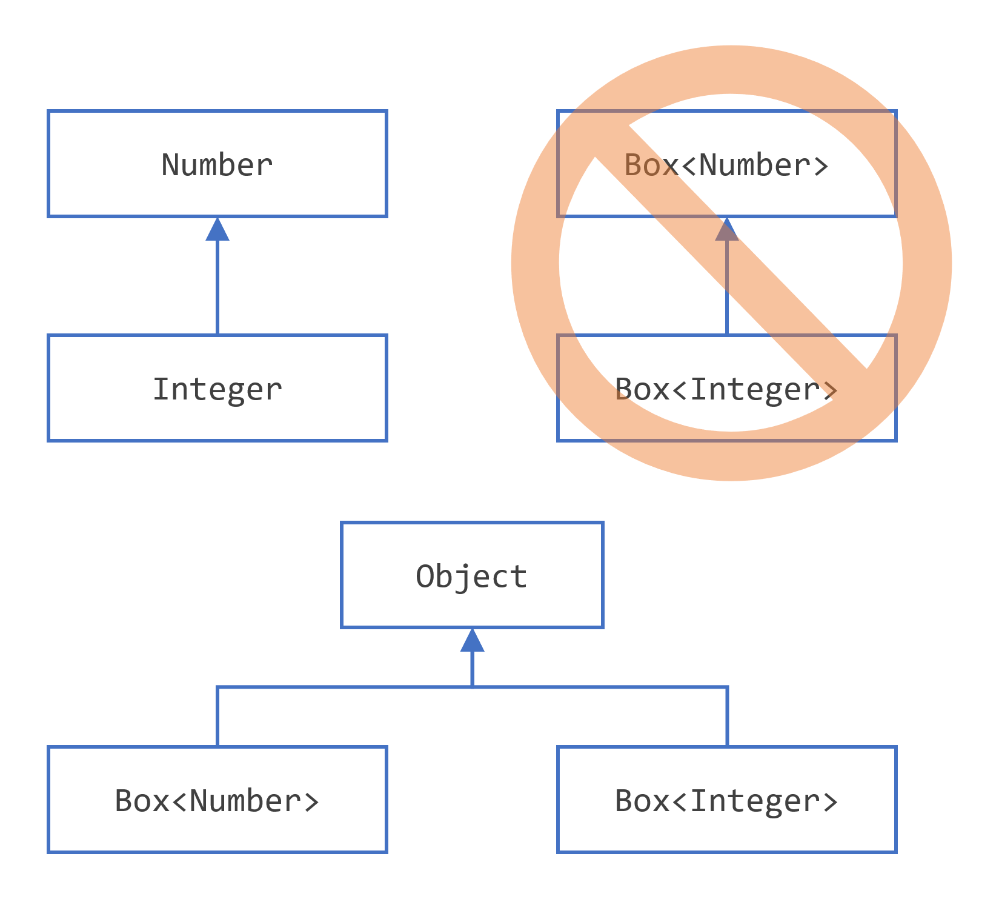
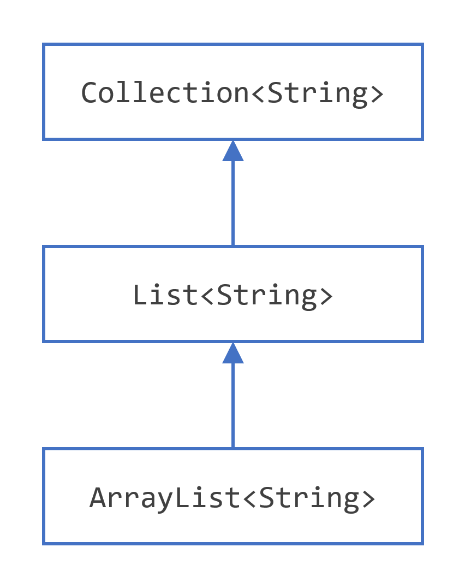
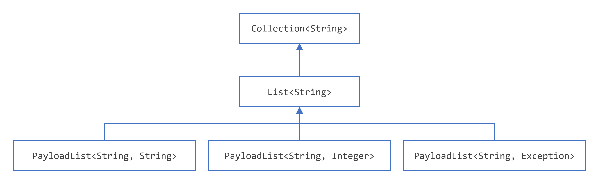
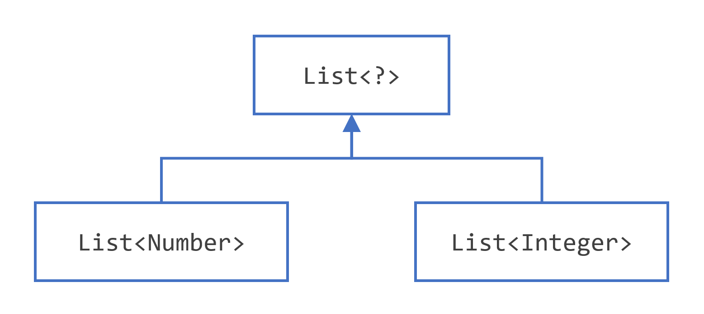
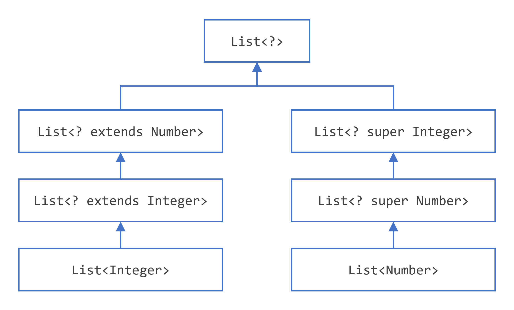
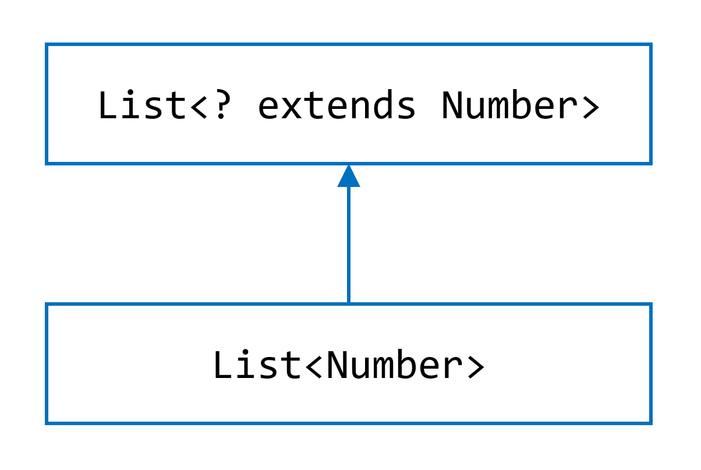
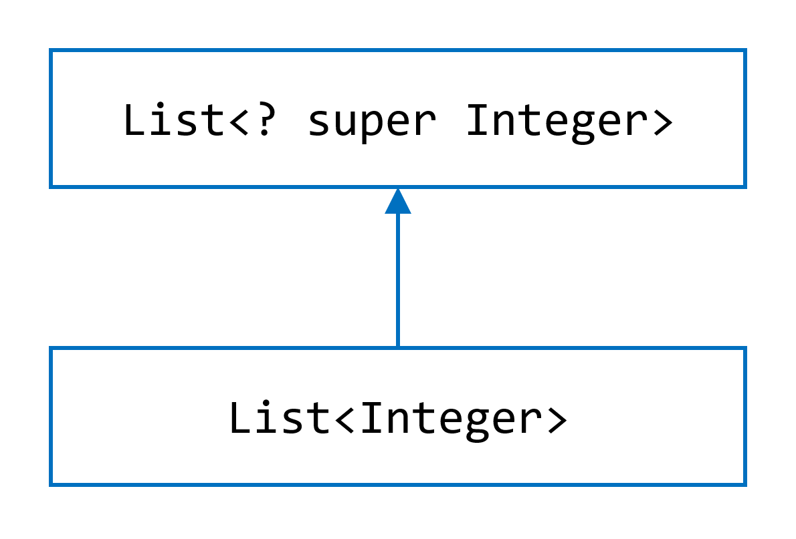

# 泛型与 Lambda（续）：类型推断、通配符与函数式编程实战

> 来源：Oracle 官方 [Dev.java 教程](https://dev.java/learn/) →《Generics》《Lambda Expressions》
> 忠实翻译，保留全部代码示例与官方配图。

---

## 一、泛型：类型推断与通配符深入

### 1. 类型推断（Type Inference）详解

**类型推断是 Java 编译器自动推断能有效调用方法、让类型实参更容易书写的能力。** 无需你显式指定类型实参，编译器就能推断出合适的类型。

**方法调用中的类型推断**：

```java
// 泛型方法
static <T> T pick(T a, T b) { return b; }

// 调用 —— 编译器推断 T 为 Serializable
Serializable s = pick("d", new ArrayList<String>());
```

**diamond 运算符**（Java SE 7 引入）：让编译器推断构造器的类型实参。

```java
Map<String, List<String>> myMap = new HashMap<>();   // <> 推断
```

**泛型构造器 + diamond**（Java SE 9 起允许匿名类中使用）：

```java
List<String> list = new ArrayList<>() {{
    add("A"); add("B");
}};
```

### 2. 上界通配符 `? extends T` —— 「生产者」语义

**上界通配符让方法能接受** `T` **或其任意子类的集合，专注于「读取」元素。**

```java
public static double sumOfList(List<? extends Number> list) {
    double s = 0.0;
    for (Number n : list) s += n.doubleValue();
    return s;
}

List<Integer> li = Arrays.asList(1, 2, 3);
System.out.println(sumOfList(li));   // 6.0
```

**关键约束**：用 `? extends Number` 声明的变量，你**只能读**，**不能往里 add**（编译器不知道具体是 `Integer`、`Double` 还是别的子类）。用 `extends` 意味着「往里放任何东西都不安全」。

### 3. 下界通配符 `? super T` —— 「消费者」语义

**下界通配符让方法能接受** `T` **或其任意超类的集合，专注于「写入」（消费）元素。**

```java
public static void addNumbers(List<? super Integer> list) {
    for (int i = 1; i <= 10; i++) list.add(i);
}

List<Object> lo = new ArrayList<>();
addNumbers(lo);        // 可放 Object 的列表
List<Number> ln = new ArrayList<>();
addNumbers(ln);        // 可放 Number 的列表
```

**关键约束**：用 `? super T` 声明的变量，你**能 add**，但**读取**到的元素只能作为 `Object` 处理（编译器只知道它是 T 的某个超类）。

### 4. 无界通配符 `?` —— 未知类型

用于两种情形：

1. 方法只使用 `Object` 提供的能力；
2. 泛型类中的方法不依赖类型参数。

```java
public static void printList(List<?> list) {
    for (Object elem : list) {
        System.out.println(elem);
    }
}
```

### 5. 通配符与子类型（重点难点）



> **核心结论**：`List<Integer>` **不是** `List<Number>` 的子类型，尽管 `Integer` 是 `Number` 的子类型。泛型类型**不可协变**（对类型参数而言）。



但**数组是协变的**：`Integer[]` 是 `Number[]` 的子类型——这曾导致经典的运行时 `ArrayStoreException` 问题。相比之下，泛型的不可协变性反而在编译期就杜绝了此类错误。

### 6. 继承与泛型的组合



一个泛型类可以让它的类型参数扩展另一个泛型类的类型参数，形成继承链。例如：

```java
public class Box<T> { ... }
public class BoundedBox<T extends Comparable<T>> extends Box<T> { ... }
```



### 7. 类型参数与子类型关系







**理解 `? extends` 与 `? super` 的对称性**是泛型掌握的关键：

- `List<? extends Number>`：你能**取出** `Number` 及其子类，但**无法安全添加**（不知道具体子类）→ 适合读。
- `List<? super Integer>`：你能**添加** `Integer` 及其子类，但取出时只能当作 `Object` → 适合写。
- 这与经典的 **PECS 原则** 吻合：**Producer Extends, Consumer Super**（生产者用 extends，消费者用 super）。

### 8. 类型擦除（Type Erasure）的本质

**类型擦除是 Java 泛型的实现手段：编译器把泛型代码中的类型参数擦除为原始类型（或受限类型的左边界），保证与非泛型旧代码的二进制兼容。**

```java
// 源码
public class Box<T> {
    public void set(T t) { ... }
    public T get() { return t; }
}

// 擦除后（编译产物等价于）
public class Box {
    public void set(Object t) { ... }   // T -> Object
    public Object get() { return t; }
}
```

对受限参数 `<T extends Number>`，`T` 被擦除为 `Number`。

**桥接方法（Bridge Methods）**：当泛型类被子类覆盖方法时，编译器会生成桥接方法以维持多态。这是擦除带来的内部机制，一般无需你手动处理。

**擦除的实际后果**：

- 运行时无法获得类型实参：`list instanceof List<String>` 编译错误。
- 无法创建参数化类型数组：`new List<String>[10]` 编译错误。
- 无法 `new T()`、`static T t`、`catch (T e)` 等，如表所示。

### 9. 泛型限制总表

| 限制 | 编译错误示例 |
|------|-------------|
| 不能用基本类型 | `Box<int>` ❌ → 用 `Box<Integer>` |
| 不能实例化类型参数 | `new T()` ❌ |
| 不能有类型参数的静态字段 | `public static T t;` ❌ |
| 不能 `instanceof` 类型参数 | `o instanceof T` ❌ |
| 不能参数化类型数组 | `new List<String>[10]` ❌ |
| 不能 catch 类型参数异常 | `catch (T e)` ❌ |
| 一个类型参数只能一个类边界 | `<T extends A extends B>` ❌ |

---

## 二、Lambda 表达式深入：方法引用与组合

### 1. 方法引用的完整形式

方法引用是 lambda 的**语法糖**，当 lambda 体只是调用一个已有方法时使用。四种形式：

**① 静态方法引用** `ClassName::staticMethod`

```java
Function<String, Integer> f = Integer::parseInt;
// 等价于 Function<String, Integer> f = s -> Integer.parseInt(s);
```

**② 特定对象的实例方法引用** `object::instanceMethod`

```java
List<String> list = Arrays.asList("a", "b");
list.forEach(System.out::println);
// 等价于 list.forEach(s -> System.out.println(s));
```

**③ 任意对象的特定类型实例方法引用** `ClassName::instanceMethod`

```java
Function<String, Integer> len = String::length;
// 等价于 Function<String, Integer> len = s -> s.length();
```

**④ 构造器引用** `ClassName::new`

```java
Supplier<List<String>> supplier = ArrayList::new;
// 等价于 Supplier<List<String>> s = () -> new ArrayList<>();
```

### 2. 用 `andThen` 与 `compose` 组合函数

**`Function.andThen`**：先执行自己，再执行参数函数（从左到右）。

```java
Function<Integer, Integer> times2 = x -> x * 2;
Function<Integer, Integer> plus1  = x -> x + 1;

Function<Integer, Integer> chain = times2.andThen(plus1);
System.out.println(chain.apply(5));   // (5*2)+1 = 11
```

**`Function.compose`**：先执行参数函数，再执行自己（从右到左）。

```java
Function<Integer, Integer> chain2 = times2.compose(plus1);
System.out.println(chain2.apply(5));   // (5+1)*2 = 12
```

### 3. 用 `Predicate` 的 `and / or / negate` 组合

```java
Predicate<String> startsWithA = s -> s.startsWith("A");
Predicate<String> endsWithE   = s -> s.endsWith("e");

Predicate<String> both   = startsWithA.and(endsWithE);
Predicate<String> either = startsWithA.or(endsWithE);
Predicate<String> notA   = startsWithA.negate();

System.out.println(both.test("Apple"));   // false（Apple 以 e 结尾吗？是，但 A/e 组合需验证）
System.out.println(either.test("Apple")); // true
System.out.println(notA.test("Banana"));  // true
```

### 4. 完整实战：用 lambda 处理集合

```java
import java.util.*;
import java.util.function.*;

public class LambdaDemo {
    public static void main(String[] args) {
        List<String> names = new ArrayList<>(List.of("Alice", "Bob", "Charlie", "Diana"));

        // 过滤长度 > 3 的名字并打印
        names.stream()
             .filter(s -> s.length() > 3)
             .forEach(System.out::println);   // Alice, Charlie, Diana

        // 用 Predicate 组合
        Predicate<String> longName = s -> s.length() > 3;
        Predicate<String> startsWithA = s -> s.startsWith("A");
        names.stream()
             .filter(longName.and(startsWithA))
             .forEach(System.out::println);   // Alice

        // Supplier + Function + Consumer
        Supplier<List<String>> listFactory = ArrayList::new;
        Function<String, Integer> length = String::length;
        Consumer<Integer> print = System.out::println;

        List<String> newList = listFactory.get();
        newList.add("hello");
        print.accept(length.apply(newList.get(0)));   // 5
    }
}
```

---

## 三、核心总结：函数式编程三件套

| 场景 | 用哪类接口 | 方法引用形式 |
|------|-----------|-------------|
| 提供数据 | `Supplier<T>` | `Class::new` |
| 消费数据（副作用） | `Consumer<T>` | `System.out::println` |
| 类型变换 | `Function<T,R>` | `String::length` |
| 过滤/测试 | `Predicate<T>` | `str::isEmpty` |
| 二元运算 | `BinaryOperator<T>` | `Math::max` |
| 比较 | `Comparator<T>` | `Person::getAge` |

> **面试高频**：泛型为何用通配符？因为泛型**不可协变**，需要 `? extends` / `? super` 表达「某个未知子类型/超类型的集合」；`PECS` 原则帮记：**Producer Extends，Consumer Super**。类型擦除是「编译期擦掉泛型信息以兼容旧代码」的实现机制，代价是运行时无法获取类型实参。

*最后更新：2021 年 9 月 14 日（官方）*
