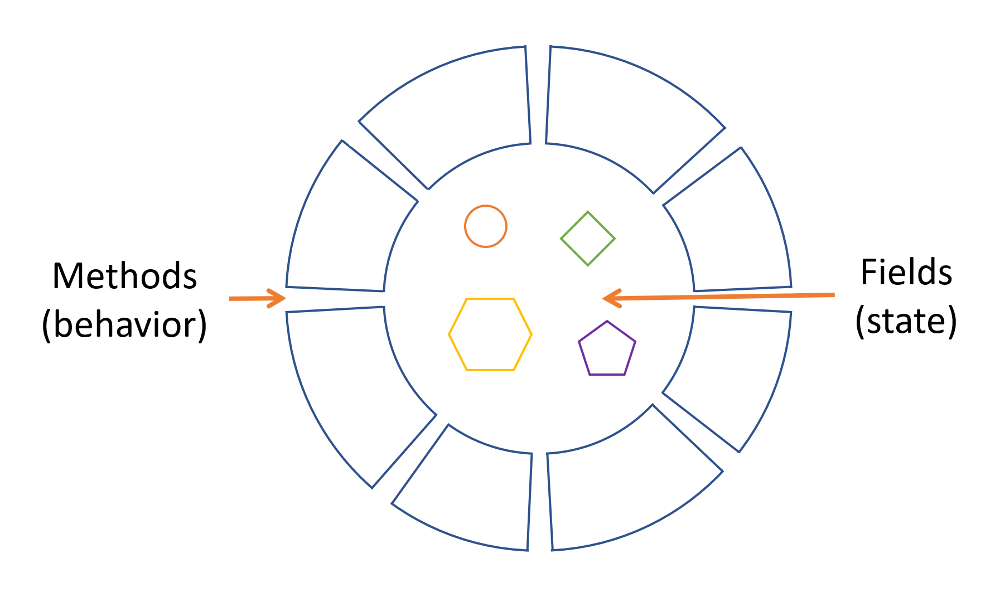
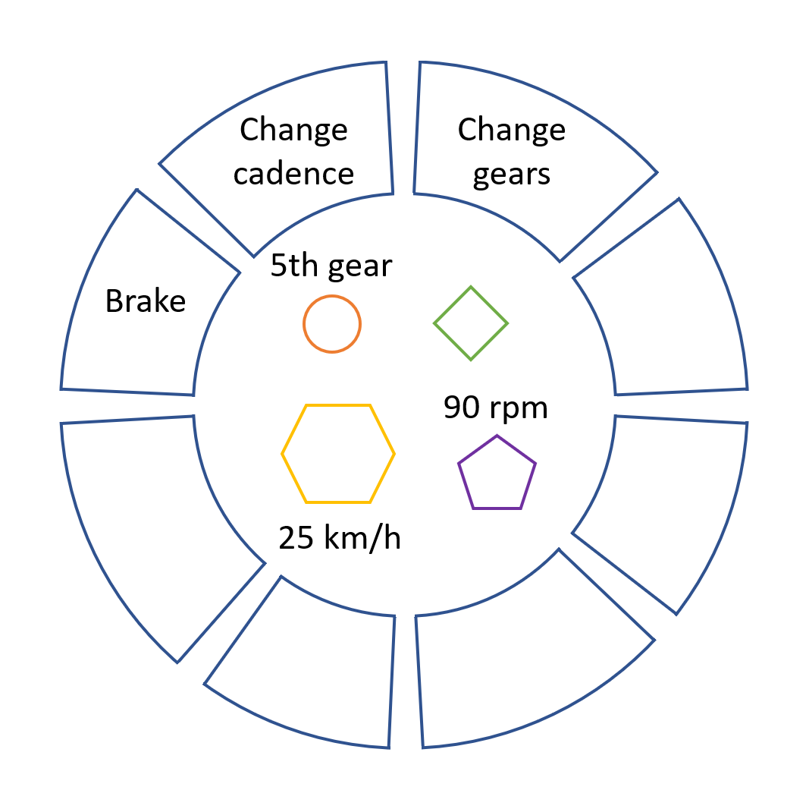
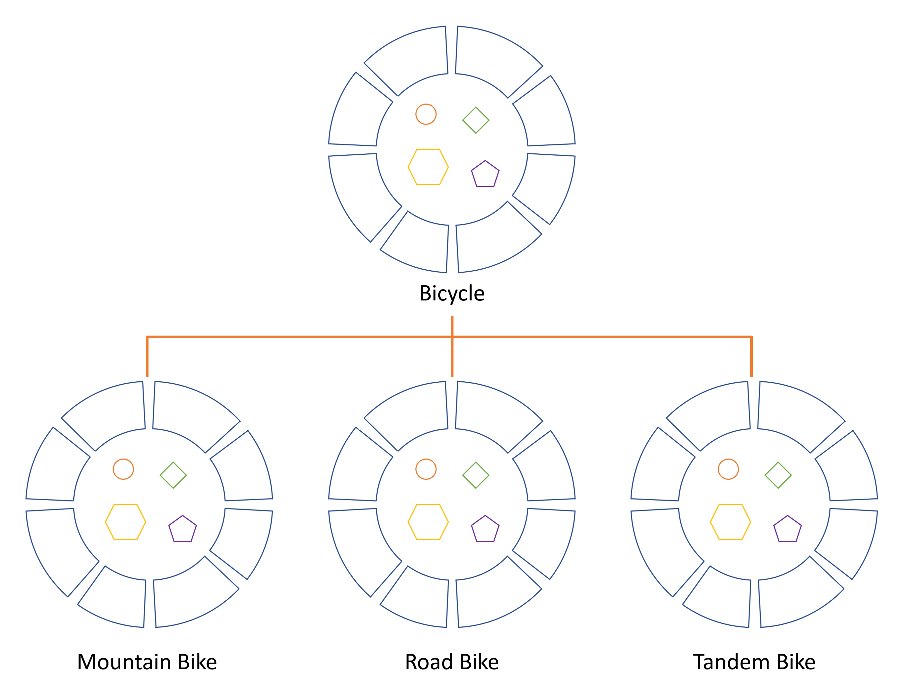

# 面向对象：对象、类、继承、接口与包

> 来源：Oracle 官方 [Dev.java 教程](https://dev.java/learn/) →《Objects, Classes, Interfaces, Packages, and Inheritance》
> 忠实翻译，保留全部代码示例与官方配图，适合后端面试复习。

如果你从未用过面向对象编程语言，在开始写任何代码之前，你需要先学习几个基本概念。本节将向你介绍**对象（object）、类（class）、继承（inheritance）、接口（interface）和包（package）**。每一部分讨论都会聚焦这些概念如何与现实世界关联，同时介绍 Java 语言的语法。

---

## 一、什么是对象（Object）？

**对象是相关状态和行为的一个软件捆绑体。** 本节解释状态和行为如何在对象内部表示，引入**数据封装（data encapsulation）** 的概念，并说明以这种方式设计软件的好处。

对象共享两个特征：它们都有**状态**和**行为**。

- 狗有状态（名字、颜色、品种、是否饥饿）和行为（吠叫、叼物、摇尾巴）。
- 自行车也有状态（当前挡位、当前踏板节奏、当前速度）和行为（换挡、改变踏板节奏、刹车）。

识别现实世界对象的状态和行为，是开始用面向对象方式思考的好方法。

现在就花一分钟观察你身边真实的物体。对每一个物体，问自己两个问题：**「这个物体可能有哪几种状态？」** 和 **「这个物体能执行哪些行为？」** 并把你的观察记下来。你会发现现实世界的物体复杂程度各异：你的台灯可能只有两种状态（开、关）和两种行为（开灯、关灯），但你的收音机可能有更多状态（开、关、当前音量、当前电台）和行为（开、关、调大音量、调小音量、搜索、扫描、调频）。你还可能注意到，有些物体本身又包含其他物体。这些现实观察是理解面向对象编程世界的起点。



### 软件对象

**软件对象由状态和相关的行为构成。** 对象把状态存储在**字段（field）**中（某些语言称为变量），并通过**方法（method）**暴露其行为（某些语言称为函数）。方法作用于对象内部状态，是对象间通信的主要机制。**隐藏内部状态、要求所有交互都通过对象的方法进行，这被称为数据封装（data encapsulation）——面向对象编程的基本原则。**

以自行车为例：



通过赋予状态（当前速度、当前踏板节奏、当前挡位）并提供修改这些状态的方法，对象就能掌控外部世界如何使用它。例如，如果自行车只有 6 个挡位，换挡方法可以拒绝任何小于 1 或大于 6 的值。

把代码捆绑进单独的软件对象带来一系列好处，包括：

1. **模块化（Modularity）**：一个对象的源代码可以独立于其他对象的源代码编写和维护。一旦创建，对象就能在系统内轻松传递。
2. **信息隐藏（Information-hiding）**：只与对象的方法交互，其内部实现细节对外界保持隐藏。
3. **代码复用（Code re-use）**：如果某个对象已存在（也许是其他开发者写的），你可以在程序里直接使用它。这让专家能实现/测试/调试复杂的、任务特定的对象，然后你可以放心地让它们在自己的代码里运行。
4. **可插拔性与调试便利（Pluggability and debugging ease）**：如果某个对象出问题，你可以直接把它从应用里移除，换一个不同的对象顶替。这类似现实世界的机械维修：螺栓断了，换螺栓，而不是换整台机器。

---

## 二、什么是类（Class）？

在你的应用中，你常会发现大量**同一种类**的独立对象。世上可能有几万辆同品牌同型号的自行车，每一辆都由同一套图纸组装、包含相同的部件。用面向对象术语说：**你的自行车是「自行车」这个对象类的一个实例（instance）。类是创建单个对象的蓝图（blueprint）。**

以下 `Bicycle` 类是自行车的一种可能实现：

```java
public class Bicycle {

    // 3 个字段，表示对象的状态
    public int cadence;
    public int gear;
    public int speed;

    // 构造器：创建对象时初始化状态
    public Bicycle(int startCadence, int startSpeed, int startGear) {
        gear = startGear;
        cadence = startCadence;
        speed = startSpeed;
    }

    // 4 个方法，定义对象与外部世界的交互
    public void setCadence(int newValue) {
        cadence = newValue;
    }

    public void setGear(int newValue) {
        gear = newValue;
    }

    public void applyBrake(int decrement) {
        speed -= decrement;
    }

    public void speedUp(int increment) {
        speed += increment;
    }
}
```

Java 语言的语法对你来说也许陌生，但这个类的设计正是基于前面关于自行车对象的讨论。字段 `cadence`、`speed`、`gear` 表示对象的状态，方法（`setCadence()`、`setGear()`、`speedUp()` 等）定义它与外部世界的交互。

你可能注意到 `Bicycle` 类**没有 `main()` 方法**。因为它不是一个完整应用，只是可能被用于应用的自行车蓝图。创建和使用 `Bicycle` 对象是应用中另一个类的职责。

下面是一个 `BicycleDemo` 类，创建两个独立的 `Bicycle` 对象并调用它们的方法：

```java
public class BicycleDemo {
    public static void main(String[] args) {

        // 创建两个不同的 Bicycle 对象
        Bicycle bike1 = new Bicycle(0, 0, 1);
        Bicycle bike2 = new Bicycle(0, 0, 5);

        // 调用对象的方法
        bike1.speedUp(10);
        bike1.setCadence(9);
        bike1.setGear(3);

        bike2.speedUp(20);
        bike2.setCadence(12);
        bike2.setGear(4);

        // 打印状态
        bike1.printStates();
        bike2.printStates();
    }
}
```

> 说明：要让上述 `BicycleDemo` 编译运行，`Bicycle` 类还需添加一个 `printStates()` 方法（打印三字段值，如 `"cadence:9 speed:10 gear:3"`）。本教程中该方法在「创建对象」一节给出完整实现。

这个测试的输出会打印两辆自行车结束时的踏板节奏、速度和挡位。

---

## 三、什么是继承（Inheritance）？

不同种类的对象之间常有某些共同之处。山地车、公路车、双人车，例如都共享自行车的特征（当前速度、当前踏板节奏、当前挡位），但各自又定义了独特的特征：双人车有两个座椅两套车把，公路车是下弯把，有些山地车多一个牙盘从而获得更低的齿比。

**面向对象编程允许类从其他类继承常用的状态和行为。** 在这个例子里，`Bicycle` 变成 `MountainBike`、`RoadBike`、`TandemBike` 的**超类（superclass）**。在 Java 语言里，每个类只允许有**一个直接超类**，而每个超类有潜力拥有**无限多个子类**：



创建子类的语法很简单。在类声明开头，用 `extends` 关键字，后面跟上要继承的类名：

```java
public class MountainBike extends Bicycle {

    // MountainBike 独有的新字段：坐垫高度
    public int seatHeight;

    // 构造器：调用超类构造器，再初始化新字段
    public MountainBike(int startHeight,
                        int startCadence,
                        int startSpeed,
                        int startGear) {
        super(startCadence, startSpeed, startGear);
        seatHeight = startHeight;
    }

    // 设置坐垫高度的新方法
    public void setHeight(int newValue) {
        seatHeight = newValue;
    }
}
```

这给了 `MountainBike` 与 `Bicycle` 完全相同的字段和方法，又让它的代码能专注于使其独特的特性。这让子类代码易于阅读。但你必须仔细记录每个超类定义的状态和行为，因为那些代码不会出现在每个子类的源文件里。

---

## 四、什么是接口（Interface）？

正如你已经学到的，**对象通过它们暴露的方法定义与外部世界的交互**。方法构成对象与外部世界的接口；例如电视机正面的按钮，就是你与塑料外壳另一侧电路之间的接口——你按「电源」键开关电视。

在它最常见的形式里，**接口是一组有方法签名但没有方法体的相关方法**。如果自行车的某种行为被指定为接口，可能如下所示：

```java
interface Bicycle {

    // 轮圈转数（每分钟）
    void changeCadence(int newValue);

    // 换挡
    void changeGear(int newValue);

    // 加速
    void speedUp(int increment);

    // 刹车
    void applyBrakes(int decrement);
}
```

要实现这个接口，你的类名要换掉（例如换成某个特定品牌的自行车，如 `ACMEBicycle`），并在类声明里用 `implements` 关键字：

```java
class ACMEBicycle implements Bicycle {

    int cadence = 0;
    int speed = 0;
    int gear = 1;

    // 编译器要求实现接口中定义的所有方法
    void changeCadence(int newValue) {
         cadence = newValue;
    }

    void changeGear(int newValue) {
         gear = newValue;
    }

    void speedUp(int increment) {
         speed = speed + increment;
    }

    void applyBrakes(int decrement) {
         speed = speed - decrement;
    }

    void printStates() {
         System.out.println("cadence:" + cadence +
                            " speed:" + speed +
                            " gear:" + gear);
    }
}
```

**实现接口让类能更正式地承诺它提供的行**为。接口在类与外部世界之间形成一份**契约（contract）**，这份契约由编译器在构建时强制校验。如果你的类声称实现某个接口，那么该接口定义的所有方法都必须出现在它的源码里，类才能成功编译。

> 注：要让 `ACMEBicycle` 实际编译，需要给被实现的接口方法加上 `public` 关键字。原因在后面「类与对象」「接口与继承」章节会讲到。

---

## 五、什么是包（Package）？

**包是组织一组相关类和接口的命名空间。** 概念上你可以把包类比成电脑上的不同文件夹：HTML 页面放一个文件夹，图片放另一个，脚本或应用再放一个。因为 Java 语言编写的软件可能由成百上千个独立类组成，把相关类和接口放进包里有条理地组织是明智的。

Java 平台提供一个庞大的类库（一组包），可适用于你自己的应用。这个类库被称为「应用程序编程接口」，即 API。它的包代表了通用编程最常见的任务。例如：

- `String` 对象包含字符串的状态和行为；
- `File` 对象让程序员轻松地创建、删除、检查、比较或修改文件系统上的文件；
- `Socket` 对象支持网络套接字的创建和使用；
- 各种 GUI 对象控制按钮、复选框以及与图形用户界面相关的其他组件。

这里有成千上万的类可供选择，这使得你——程序员——能专注于你特定应用的设计，而非让它运转所需的基础设施。

**Java 平台 API 规范**（Java Platform API Specification）包含 Java SE 平台提供的所有包、接口、类、字段和方法的完整清单。在浏览器中打开这个页面并收藏它。作为程序员，它将成为你最重要的参考文档。

---

## 六、核心概念速查表

| 概念 | 中文 | 一句话理解 | 关键语法 |
|------|------|-----------|----------|
| Object | 对象 | 状态 + 行为的捆绑体，现实世界事物的软件模型 | `new Bicycle(0,0,1)` |
| Class | 类 | 创建对象的蓝图 | `class Bicycle { ... }` |
| Field | 字段 | 对象内部存储状态 | `public int speed;` |
| Method | 方法 | 对象暴露的行为 | `public void speedUp(int i)` |
| Inheritance | 继承 | 子类复用超类的字段和方法 | `class MountainBike extends Bicycle` |
| Interface | 接口 | 一组方法的契约，可多实现 | `class ACMEBicycle implements Bicycle` |
| Package | 包 | 组织相关类的命名空间 | `package com.example;` |
| Encapsulation | 封装 | 隐藏内部状态，经方法交互 | private 字段 + public 方法 |
| Superclass / Subclass | 超类 / 子类 | 被继承的类 / 继承的类 | — |
| Constructor | 构造器 | 创建对象时初始化状态 | `public Bicycle(...)` |

---

## 本模块后续小节

- 类的完整定义（声明类、成员变量、定义方法、提供构造器、创建/使用对象、`this`、嵌套类、初始化块）
- 继承深入（方法覆盖与隐藏、多态、抽象类、Object 超类、类型转换）
- 接口深入（定义接口、实现接口、接口作为类型、默认方法、静态方法）

> 以上小节将在「面向对象」模块的后续文档中逐一展开，均忠实于官方原文并保留完整代码示例与配图。

*最后更新：2021 年 9 月 14 日（官方）*
