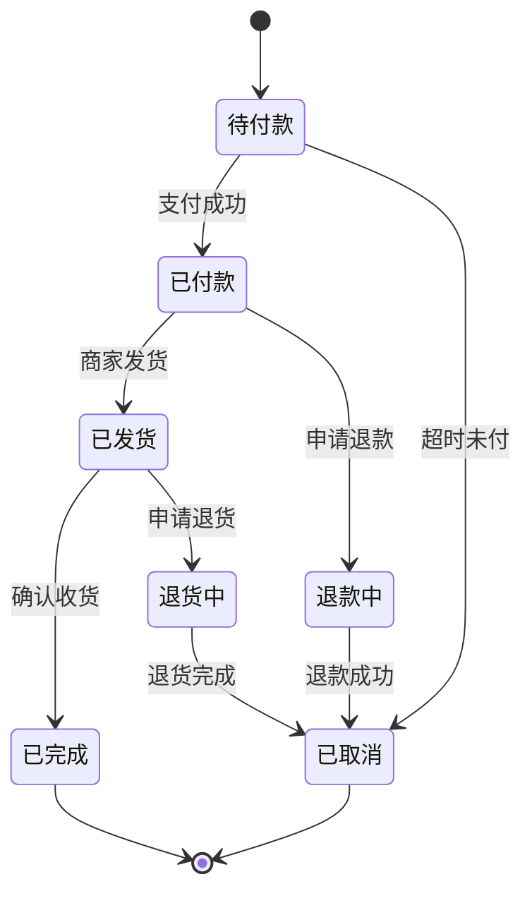

# 测试用例设计方法论教程（软件测试人员专用）

> 本教程面向软件测试工程师，系统讲解测试用例设计方法，从等价类划分、边界值分析到判定表、状态迁移、正交试验，帮助你用更少的用例覆盖更多场景。

    📙 进阶难度
    ⏱ 约 2 天
    📋 前置：软件测试理论基础
    🎯 目标：掌握 7 种经典用例设计方法并能组合使用

---

## 前置要求

| 项目 | 要求 | 获取方式 |
|------|------|----------|
| 软件测试理论基础 | 了解测试流程、用例设计、缺陷管理 | [软件测试理论基础教程](软件测试理论基础教程.md) |

---

## 新手导读

很多新手写用例靠"拍脑袋"——想到什么测什么。这种方式的问题是：容易遗漏关键场景，也容易重复测试不重要的地方。

系统化的用例设计方法能帮你：

1. **更全面**：不遗漏重要场景。
2. **更高效**：用更少的用例覆盖更多情况。
3. **更专业**：面试和工作中展示你的方法论。

第一遍先记住：

```text
等价类划分：把输入分成"等价"的组，每组测一个代表。
边界值分析：重点测边界（最小值、最大值附近）。
判定表：多个条件组合时，用表格穷举。
状态迁移：有状态变化的系统，测状态流转。
正交试验：太多因素组合时，用最少用例覆盖两两组合。
```

---

## 一、为什么需要系统化的用例设计方法

### 1.1 拍脑袋设计的缺点

```text
场景：测试一个"年龄"输入框（要求 1-120 的整数）

拍脑袋的测试：
- 输入 25 → 通过 ✓
- 输入 100 → 通过 ✓

问题：
- 没测 0、-1（下边界外）
- 没测 121（上边界外）
- 没测 1、120（边界值）
- 没测小数、字母、空值、超长数字
```

### 1.2 方法论的价值

| 方法 | 适用场景 | 核心思想 |
|------|----------|----------|
| 等价类划分 | 输入参数有取值范围 | 分组，每组测一个 |
| 边界值分析 | 输入参数有上下限 | 重点测边界 |
| 判定表 | 多个条件组合 | 穷举所有组合 |
| 状态迁移 | 系统有状态变化 | 测状态流转路径 |
| 正交试验 | 因素太多无法穷举 | 两两组合覆盖 |
| 错误推测法 | 任何场景 | 基于经验猜 Bug |
| 场景法 | 有业务流程 | 测基本流+备选流 |

---

## 二、等价类划分

### 2.1 什么是等价类

把所有可能的输入分成若干组（等价类），从每组中取一个代表来测试。假设：如果一个值能通过测试，同组的其他值大概率也能通过。

```text
两种等价类：
- 有效等价类：符合要求的输入（应该通过）
- 无效等价类：不符合要求的输入（应该报错）
```

### 2.2 实战：注册表单

需求：用户注册，年龄要求 1-120 的整数。

| 等价类 | 输入范围 | 测试值 | 预期结果 |
|--------|----------|--------|----------|
| 有效等价类 | 1-120 的整数 | 25 | 注册成功 |
| 无效等价类（太小） | < 1 | 0 | 提示"年龄必须≥1" |
| 无效等价类（太大） | > 120 | 200 | 提示"年龄必须≤120" |
| 无效等价类（非数字） | 字母/符号 | abc | 提示"请输入数字" |
| 无效等价类（小数） | 小数 | 25.5 | 提示"请输入整数" |
| 无效等价类（空） | 空值 | （空） | 提示"年龄不能为空" |

### 2.3 更多等价类划分示例

| 输入项 | 有效等价类 | 无效等价类 |
|--------|-----------|-----------|
| 手机号（11位） | 13800138000 | 1380013800（10位）、138001380000（12位）、abcdefghijk |
| 密码（8-20位） | Test@123 | Test@1（太短）、空值、纯空格 |
| 邮箱 | test@example.com | test@、@example.com、test |
| 订单金额（>0） | 99.99 | 0、-1、空值 |

---

## 三、边界值分析

### 3.1 什么是边界值

经验表明：Bug 更容易出现在边界上。边界值分析法要求在等价类的边界附近取值测试。

```text
边界值选取规则（以范围 [min, max] 为例）：

min - 1  →  刚好低于下限（应报错）
min      →  刚好等于下限（应通过）  ← 边界
min + 1  →  刚好高于下限（应通过）
max - 1  →  刚好低于上限（应通过）
max      →  刚好等于上限（应通过）  ← 边界
max + 1  →  刚好高于上限（应报错）
```

### 3.2 实战：商品数量输入框

需求：购买数量要求 1-999 的整数。

| 边界值 | 输入 | 预期结果 | 测试类型 |
|--------|------|----------|----------|
| min - 1 | 0 | 提示"最少购买1件" | 无效边界 |
| min | 1 | 添加成功 | 有效边界 |
| min + 1 | 2 | 添加成功 | 有效内部 |
| max - 1 | 998 | 添加成功 | 有效内部 |
| max | 999 | 添加成功 | 有效边界 |
| max + 1 | 1000 | 提示"最多购买999件" | 无效边界 |

### 3.3 常见边界陷阱

| 场景 | 容易遗漏的边界值 |
|------|------------------|
| 数值范围 | 0、-1、最大值、最小值 |
| 字符串长度 | 空字符串、单字符、最大长度、超长 |
| 列表/数组 | 空列表、单元素、满页、翻页 |
| 日期 | 月末、年末、闰年2月29日、跨时区 |
| 分页 | 第1页、最后一页、超出页码 |

---

## 四、判定表（因果图）

### 4.1 什么是判定表

当多个条件组合决定一个结果时，用判定表穷举所有可能的组合，确保不遗漏。

```text
判定表的四个部分：
- 条件（Condition）：输入条件，如"是否VIP"
- 动作（Action）：输出结果，如"打9折"
- 条件项：每个条件的取值（是/否）
- 动作项：每种组合对应的动作
```

### 4.2 实战：订单折扣规则

需求：

```text
规则：
- VIP 用户且满 200 元 → 打 8 折
- VIP 用户不满 200 元 → 打 9 折
- 非 VIP 且满 200 元 → 打 9.5 折
- 非 VIP 且不满 200 元 → 无折扣
- 以上叠加新人券再减 10 元（仅限首单）
```

**判定表：**

| 规则 | R1 | R2 | R3 | R4 | R5 | R6 |
|------|----|----|----|----|----|----|
| **条件：VIP** | Y | Y | N | N | Y | N |
| **条件：满200元** | Y | N | Y | N | Y | Y |
| **条件：首单** | N | N | N | N | Y | Y |
| **动作：折扣** | 8折 | 9折 | 9.5折 | 无 | 8折 | 9.5折 |
| **动作：减10元** | 否 | 否 | 否 | 否 | 是 | 是 |

### 4.3 判定表简化

当条件项太多时（如 5 个条件 = 2^5 = 32 种组合），可以：

1. **排除不可能的组合**（如"已注销"且"有余额"）。
2. **合并相似规则**（如两个规则只在不影响动作的条件上不同）。
3. **使用正交试验法**替代穷举（见第六节）。

---

## 五、状态迁移法

### 5.1 什么是状态迁移

许多系统有状态变化（如订单、工单、审批流）。状态迁移法通过绘制状态流转图，确保覆盖所有合法的状态转换路径。

```text
三个核心概念：
- 状态（State）：系统当前所处的状态
- 事件（Event）：触发状态变化的操作
- 迁移（Transition）：从一个状态到另一个状态的变化
```

### 5.2 实战：订单状态流转



> 画状态迁移图时，重点检查**每个状态的入边和出边是否完整**，以及是否存在**非法跳转**（例如「已取消 → 已付款」应当被拒绝）。

**状态迁移表：**

| 当前状态 | 事件 | 下一状态 | 测试用例 |
|----------|------|----------|----------|
| 待付款 | 支付成功 | 已付款 | 正常支付流程 |
| 待付款 | 超时未付 | 已取消 | 30分钟未支付自动取消 |
| 已付款 | 商家发货 | 已发货 | 商家后台操作发货 |
| 已付款 | 申请退款 | 退款中 | 付款后立即退款 |
| 已发货 | 确认收货 | 已完成 | 用户点击确认收货 |
| 已发货 | 申请退货 | 退货中 | 收到货后申请退货 |
| 退款中 | 退款成功 | 已取消 | 退款到账 |
| 退货中 | 退货完成 | 已取消 | 退货成功 |

### 5.3 测试覆盖准则

| 覆盖级别 | 要求 | 用例数 |
|----------|------|--------|
| 状态覆盖 | 每个状态至少到达一次 | 最少 |
| 迁移覆盖 | 每条迁移至少走一次 | 推荐 |
| 迁移对覆盖 | 每两个相邻的迁移组合至少走一次 | 更全面 |

### 5.4 状态迁移图画法

```text
画图步骤：
1. 列出所有状态
2. 列出所有事件
3. 用箭头连接：状态A --事件--> 状态B
4. 检查每个状态的入边和出边是否完整
5. 标记起始状态和终止状态
```

---

## 六、正交试验法（Pairwise）

### 6.1 问题：组合爆炸

```text
场景：兼容性测试

因素：
- 浏览器：Chrome、Firefox、Safari、Edge（4种）
- 操作系统：Windows、macOS、Linux（3种）
- 分辨率：1920×1080、1366×768、2560×1440（3种）
- 语言：中文、英文（2种）

穷举：4 × 3 × 3 × 2 = 72 条用例！

问题：时间和资源不允许测 72 条。
```

### 6.2 Pairwise 原理

Pairwise（成对测试）保证每两个因素的任意取值组合至少出现一次。

```text
关键思想：大多数 Bug 由两个因素的交互引起，而不是三个或更多。

Pairwise 用例数：大约 10-15 条（vs 穷举 72 条）
覆盖率：任意两个因素的所有组合都被覆盖
```

### 6.3 实战：兼容性测试

使用 Pairwise 生成的用例（示例）：

| 用例 | 浏览器 | OS | 分辨率 | 语言 |
|------|--------|-------|--------|------|
| 1 | Chrome | Windows | 1920×1080 | 中文 |
| 2 | Chrome | macOS | 1366×768 | 英文 |
| 3 | Chrome | Linux | 2560×1440 | 中文 |
| 4 | Firefox | Windows | 1366×768 | 中文 |
| 5 | Firefox | macOS | 2560×1440 | 英文 |
| 6 | Firefox | Linux | 1920×1080 | 英文 |
| 7 | Safari | Windows | 2560×1440 | 英文 |
| 8 | Safari | macOS | 1920×1080 | 中文 |
| 9 | Safari | Linux | 1366×768 | 中文 |
| 10 | Edge | Windows | 1920×1080 | 英文 |
| 11 | Edge | macOS | 1366×768 | 中文 |
| 12 | Edge | Linux | 2560×1440 | 英文 |

```text
从 72 条缩减到 12 条，节省 83% 的测试工作量！
```

### 6.4 Pairwise 工具

**PICT（微软出品）：**

```bash
# 安装
# Windows: 下载 https://github.com/microsoft/pict/releases
# Linux: apt install pict

# 创建因素文件 factors.txt
cat > factors.txt << EOF
浏览器: Chrome, Firefox, Safari, Edge
操作系统: Windows, macOS, Linux
分辨率: 1920x1080, 1366x768, 2560x1440
语言: 中文, 英文
EOF

# 生成 Pairwise 组合
pict factors.txt
```

**Python 实现：**

```python
# pip install allpairspy
from allpairspy import AllPairs

parameters = [
    ["Chrome", "Firefox", "Safari", "Edge"],
    ["Windows", "macOS", "Linux"],
    ["1920x1080", "1366x768", "2560x1440"],
    ["中文", "英文"],
]

for i, pairs in enumerate(AllPairs(parameters)):
    print(f"用例 {i+1}: {pairs}")
```

---

## 七、错误推测法

### 7.1 什么是错误推测法

基于经验和直觉，推测系统可能在哪里出错，然后针对性地设计测试用例。

!!! tip "经验的价值"
    错误推测法不是"拍脑袋"，而是基于对常见 Bug 模式的了解。有经验的测试人员知道哪些地方最容易出问题。

### 7.2 常见错误模式清单

| 类别 | 常见错误 | 测试方法 |
|------|----------|----------|
| **空值** | 必填项为空 | 提交空表单 |
| **特殊字符** | SQL 注入、XSS | 输入 `

做完点「检查答案」，每题都会给出具体提示。全对之后，本页会在学习进度里
自动标记为已通过（进度存在浏览器本地，换设备不会同步）。

---

### 推荐下一步

根据你的学习进度，选择下一步：

1. **如果你想练习用例设计**：学习 [探索式测试教程](探索式测试教程-软件测试版.md)，掌握动态测试思维
2. **如果你想学接口测试**：学习 [接口测试完整教程](../专项测试/接口测试完整教程-软件测试版.md)，将方法论应用到接口
3. **如果你想准备面试**：学习 [软件测试面试题](../面试专题/软件测试面试题.md)，用例设计是面试高频考点

### 阶段测验

完成教程后，建议做 [测试用例设计测验](测试用例设计测验.md) 检验学习效果。

### 通关检查

完成本阶段后，使用 [第1阶段-测试入门通关](../学习中心/第1阶段-测试入门通关.md) 检查是否可以进入下一阶段。
